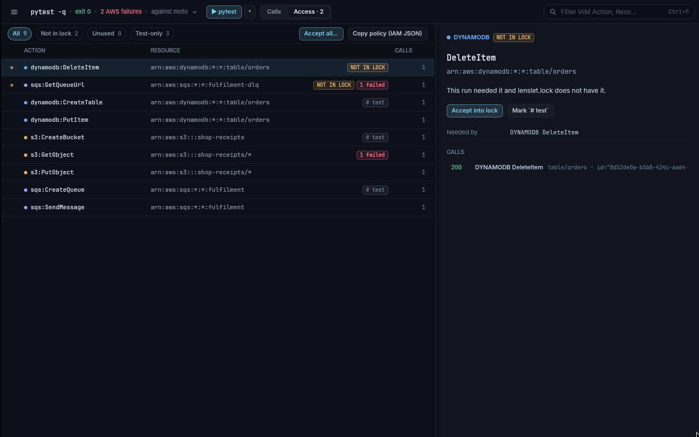

# Lenslet

**See, in every pull request, what AWS access your code needs, and why its
AWS calls failed.**

Lenslet runs your tests against a local AWS emulator: the one you already run
(AWS Emulator, LocalStack, moto), or moto, which Lenslet starts and stops for
you. It records every AWS call, explains the ones that fail, and works out the
IAM permissions the code uses. It keeps those permissions in `lenslet.lock`,
a file you commit. When a pull request widens AWS access, the PR says so,
call by call, and CI fails until someone accepts the change.

> **Lenslet · `pytest` passed**
>
> 9 AWS calls · 2 errors · 3 services · against moto
>
> **2 permissions not in `lenslet.lock`.** Review them; if they are intended, run `lenslet run --update` and commit `lenslet.lock`.
>
> | | Permission | Resource | Needed by |
> |---|---|---|---|
> | + | `dynamodb:DeleteItem` | `arn:aws:dynamodb:*:*:table/orders` | DYNAMODB DeleteItem |

## Start

```bash
curl -fsSL https://github.com/hxddh/lenslet/releases/latest/download/install.sh | sh
pip install 'moto[server]'      # only if you don't run an emulator already

lenslet pytest                  # or: lenslet npm test / lenslet cargo test
lenslet init                    # writes lenslet.lock and a GitHub Actions workflow
```

Lenslet uses the emulator that is already running: a loopback
`AWS_ENDPOINT_URL`, AWS Emulator on 9298, LocalStack on 4566 or moto on 5000,
each recognized by its protocol. When none is running and moto is installed,
it starts moto on a free port for the run and stops it after. When moto is not
installed either, it stops with the install command. Every report says what
answered: `· against moto (started by Lenslet)`.

`lenslet init` detects your test command (`pytest`, `npm`/`pnpm`/`yarn`/`bun`,
`cargo test`, `go test ./...`, `make test`), writes `lenslet.lock` and adds
`.github/workflows/lenslet.yml` (an existing workflow is kept unless you pass
`--force`). Review the lock, mark fixture-only lines with `# test`, and commit
both files.

## What a run shows

```console
$ lenslet run --check -- pytest -q
...your tests...
lenslet: 9 calls · 2 errors · 3 services (dynamodb, s3, sqs) · 778 ms · against moto (started by Lenslet)
  ✗ S3 GetObject  404  NoSuchKey  The specified key does not exist.
      → The resource does not exist in the emulator. Was it created in this run, in the same region?
  ✗ SQS GetQueueUrl  400  QueueDoesNotExist  The specified queue does not exist.
  access: 2 permissions not in lenslet.lock
    + dynamodb:DeleteItem              arn:aws:dynamodb:*:*:table/orders
    + sqs:GetQueueUrl                  arn:aws:sqs:*:*:fulfilment-dlq
```

- **Why calls failed**: each failure with its AWS error and its likely cause,
  including cross-call correlation (a region mismatch against an earlier
  `CreateTable`/`CreateQueue`, a resource deleted earlier in the run, common
  local setup gaps), and what failed since the previous run of the same
  command.
- **What the code needs**: each call becomes the IAM actions it needs on
  resource ARNs, with account and region as `*`. That covers batches (one
  entry per table or parameter), transactions (each item's action), copies
  (the source read), S3 subresources and versioned requests, qualified Lambda
  functions, KMS aliases (authorized on the key), Bedrock inference profiles
  (and their foundation model), API Gateway management calls, and the KMS
  keys and `iam:PassRole` a request names. Generated names (UUIDs,
  timestamps) become `*`, so the lock stays stable. The mapping is checked
  against a corpus of 300 recorded SDK calls whose expected permissions were
  written by hand from the AWS Service Authorization Reference
  (`crates/core/tests/corpus`).

This is **observed** access: what your tests exercised. It is not a security
review, and code paths the tests never reach are not in the lock.

### The lock

```text
# lenslet.lock
dynamodb:CreateTable  arn:aws:dynamodb:*:*:table/orders  # test
dynamodb:PutItem      arn:aws:dynamodb:*:*:table/orders
s3:GetObject          arn:aws:s3:::shop-receipts/*
```

One permission per line, sorted. `# test` marks access only the tests need
(fixtures creating tables or buckets): `--check` still counts it, `lenslet
policy` leaves it out. A lock grants exactly its lines. `lenslet run --update`
rewrites it, only when the command passed; the window can accept lines and
toggle `# test`. Every write is atomic and keeps `# test` marks and the
comment block at the top.

### Checking a real policy

```console
$ lenslet check --policy deploy/role.json
lenslet check: run 20261122-105419-23961 against role.json · 8 calls · 1 permission denied
  ✗ dynamodb:DeleteItem  arn:aws:dynamodb:us-east-1:*:table/orders  (DYNAMODB DeleteItem)
      → denied by statement `NoDelete`
```

`lenslet check` takes the newest finished run in the current directory (or
the one you name) and checks every permission it used against an IAM policy,
without re-running your tests. It uses the exact access derived during the
run. It names the statement that denies each permission, or says that nothing
allows it. A statement with a `Condition` is reported as conditional and not
evaluated: it never counts as allowing. Exit code 3 means something was
denied or conditional.

## In CI

The workflow `lenslet init` writes uses the Lenslet action:

```yaml
permissions:
  contents: read
  pull-requests: write          # one PR comment, updated in place
steps:
  - uses: actions/checkout@v5
  # install your test dependencies
  - uses: hxddh/lenslet@lenslet-v13.0.0
    with:
      command: pytest
      upstream: moto            # the action installs moto; Lenslet starts and stops it
```

It installs the pinned Lenslet (checking its checksum), runs your command with
`--check`, writes the report to the job summary, and keeps one PR comment up
to date. Until a `lenslet.lock` exists, it only reports.

| input | default | |
| --- | --- | --- |
| `command` | — | the test command (bash, in `working-directory`) |
| `upstream` | `auto` | `auto` (an emulator already running in the job, else moto if installed), `moto` (installed and managed for you), a port (AWS Emulator, HTTPS on 127.0.0.1) or a URL |
| `emulator` | | `moto`, or a command that starts the emulator in the background |
| `working-directory` | `.` | where to run and find the lock |
| `lock` | `lenslet.lock` | lock path, relative to `working-directory` |
| `policy` | | an IAM policy JSON; after the run, `lenslet check --policy` fails the job if it denies anything |
| `strict` | `false` | also fail when the lock lists access the run did not use |
| `comment` | `true` | post or update the PR comment (fork PRs get the job summary only) |
| `version` / `binary` | the pinned tag | another release, or a binary you built |

Outputs: `exit-code`, `report` (the JSON report) and `markdown` (the PR
comment).

## The window

`lenslet ui` (or `Lenslet.app`) opens the window on your project.
`lenslet run --ui -- <tests>` opens it on a run as it happens.


- **Header**: the run (`pytest -q · exit 0 · 2 AWS failures · against moto`;
  switch runs with `⌘[` / `⌘]`), **▶ your test command** (`⌘R`, `⌘.` to stop;
  `▾` edits the command, which comes from the same detection as `lenslet
  init`), **Calls | Access**, and search.
- **Calls** (`⌘1`): the run's findings first (its failures, what is new or
  fixed since the previous run, and how many permissions are not in the
  lock), then the calls. A run opens on its first failure. `⌘J` shows the
  test command's output.
- **Access** (`⌘2`): every permission the run used, marked not in the lock,
  unused or `# test`. Accept one (`a`), accept all (`⌘⇧A`, after a
  confirmation that lists them), remove (`⌫`), toggle `# test` (`t`), or copy
  the IAM policy.
- **Inspector** (`⌘B`): why the call failed, the permissions it needs, and
  its request and response, decoded or raw.



`⌘F` or `/` searches calls, headers and bodies. `j`/`k` or the arrow keys
move, `Enter` goes into the inspector and `Esc` backs out. On Linux every `⌘`
is `Ctrl`. The window follows the system appearance and speaks English or
中文 (the ☰ / app menu). It reads run files and never touches the disk while
drawing; ▶ runs `lenslet run` in your project and stops it cleanly.

## For agents

Every run ends with one JSON report, the same object in two places: the last
line of the run file, and `lenslet run --json PATH` (`-` for stdout).
`--markdown PATH` writes the PR-comment version. `lenslet doctor --json` says
which emulators are running, whether moto is available, the detected test
command, the lock and the CI workflow.

| exit code | meaning |
| --- | --- |
| the command's | the command failed |
| `3` | the command passed, but `--check` found access not in the lock (or, with `--strict`, unused); or `lenslet check` found a denied or conditional permission |
| `2` | Lenslet could not run |
| `0` | otherwise |

The run-file format (version 4) is in [docs/trace.md](docs/trace.md).

## Commands

```text
lenslet COMMAND [ARGS...]                      shorthand for `lenslet run -- COMMAND`
lenslet run [options] [--] COMMAND [ARGS...]   run your tests under Lenslet
lenslet check --policy PATH [RUN] [--json] [--markdown PATH]
                                               would a recorded run pass under this policy?
lenslet policy [--lock PATH | --run RUN]       an IAM policy (JSON) from the lock (without `# test`) or a run
lenslet init [--emulator moto | --upstream ADDRESS] [--force] [-- COMMAND]
                                               lenslet.lock + CI workflow
lenslet doctor [--json]                        emulators, moto, test command, lock, CI
lenslet ui                                     the window

run: --check  --strict  --update  --lock PATH  --json PATH  --markdown PATH  --quiet  --ui
     --emulator moto  --upstream ADDRESS  --allow-docker  --emulator-ca PATH  --trace PATH
```

For the test command, `lenslet run` sets `AWS_ENDPOINT_URL`, the emulator's
credentials and config when you have not set your own, and placeholder keys
otherwise. It always removes ambient cloud credentials (`AWS_ACCESS_KEY_ID`,
`AWS_SECRET_ACCESS_KEY`, `AWS_SESSION_TOKEN`, `AWS_PROFILE`,
`AWS_WEB_IDENTITY_TOKEN_FILE`, `AWS_ROLE_ARN`, `AWS_CONTAINER_CREDENTIALS_*`,
`AWS_BEARER_TOKEN_BEDROCK`) and the service-specific `AWS_ENDPOINT_URL_*`
variables that would send calls around the proxy, so real credentials never
reach the emulator or the local run files.

## Install

| | |
| --- | --- |
| any Linux, macOS (CLI) | `curl -fsSL https://github.com/hxddh/lenslet/releases/latest/download/install.sh \| sh` |
| macOS (app + CLI) | `… \| sh -s -- --app`, or `Lenslet-X.Y.Z.dmg` (universal). The CLI is inside the app at `Lenslet.app/Contents/MacOS/lenslet`. |
| Linux (CLI + window) | `lenslet-X.Y.Z-{x86_64,aarch64}-linux.tar.gz` (glibc ≥ 2.35) |
| CI images, Alpine | `lenslet-cli-X.Y.Z-{x86_64,aarch64}-linux-musl.tar.gz`: static |

Every asset is listed in the release's `SHA256SUMS`, and `install.sh` checks
the file it downloads against it. With `--app` it moves an existing
`Lenslet.app` aside instead of deleting it, and prints the command that
clears the quarantine flag (the app is not notarized). To uninstall, delete
the binary (or the app) and `~/.lenslet`.

## Files

| path | what |
| --- | --- |
| `lenslet.lock` | the access your project needs; commit it |
| `.github/workflows/lenslet.yml` | written by `lenslet init` |
| `~/.lenslet/runs/<run>.jsonl` | one file per run (header, calls, report); the last 20 finished runs are kept |
| `~/.lenslet/runs/<run>.log` | the test command's output |
| `~/.lenslet/runs/<run>.emulator.log` | moto's output, when Lenslet started moto |

Run files hold raw headers and text bodies, and are written owner-only
(`0600`). Do not commit them.

## Build from source

You need Rust 1.88+. The window also needs the GPUI Linux libraries
(`libxkbcommon-dev`, `libxkbcommon-x11-dev`, `libwayland-dev`,
`libx11-xcb-dev`, `libxcb1-dev`, `libvulkan-dev`, `libfontconfig1-dev`,
`libfreetype-dev`, `pkg-config`, `cmake`, `clang`) and a Vulkan driver.

```bash
cargo build --release -p lenslet          # CLI: no graphics libraries
cargo build --release -p lenslet-ui       # the window
cargo test --workspace
```

```text
crates/core    lenslet-core: the facts — run-file schema, access derivation,
               the lock, policy checks, failure causes, reports
crates/cli     lenslet: the proxy, the run file, the emulator, commands
crates/ui      lenslet-ui: the window, on lenslet-core
action.yml     the GitHub Action
install.sh     the installer
examples/      a project the action is tested against
```

## Limits

- Local only. An upstream must resolve to loopback or a private container
  network; AWS domains are refused. The proxy serves loopback only;
  `--allow-docker` also serves Docker networks (172.16.0.0/12,
  192.168.65.0/24). HTTP/1.1 and HTTP/2 (`h2c`).
- What Lenslet reports about responses is what your emulator answered; the
  report names it.
- Bodies are read whole to derive access (gzip, `aws-chunked` and CBOR are
  decoded); run files keep the first 1 MiB of each body's text. A body that
  cannot be read (binary) gives its action on `*`, marked unverified.
- `lenslet check` does not evaluate `Condition` blocks; it reports them.
- Services whose resources are not derived get `*`, and calls with an
  unrecognized operation are reported as unmapped rather than guessed.
- No Windows build. The macOS app is not notarized.
- Run files from Lenslet before 13.0 are not read.

Earlier versions: [lenslet-v12.0.0](https://github.com/hxddh/lenslet/tree/lenslet-v12.0.0),
[lenslet-v11.0.0](https://github.com/hxddh/lenslet/tree/lenslet-v11.0.0),
[lenslet-v8.0.0](https://github.com/hxddh/lenslet/tree/lenslet-v8.0.0).

## License

Apache-2.0. The bundled fonts are under the SIL Open Font License; see
`assets/fonts/`.
