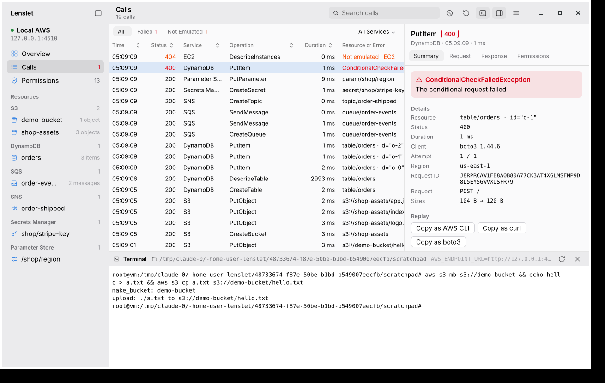

# Lenslet

**A local AWS account in a window.**

Lenslet is a desktop app with AWS inside it. Open it and you have an empty
AWS account on `http://127.0.0.1:4510`: S3, DynamoDB, SQS, SNS, Lambda, IAM
and eight more services, emulated in-process by
[AWS Emulator](https://github.com/aws/aws-emulator). Point any SDK or the AWS
CLI at it and watch what your code does:

- **Every call, live.** Service, operation, status, time, and the full
  request and response.
- **Every resource.** The buckets, tables, queues, topics and functions your
  code made, with object, item and message counts, as soon as they exist.
- **Why it failed.** A failing call says what went wrong in plain words; the
  first failure is selected for you. Calls to operations the emulator does
  not support are marked "not emulated", so you know it is not your code.
- **The IAM policy it needs.** Every permission the session used, compiled
  into one least-privilege policy you can copy.
- **Fresh start.** One click gives you a new, empty account. No containers,
  no cleanup scripts.



## Use it

Open Lenslet, click the endpoint in the header to copy the environment, and
paste it into a shell:

```bash
export AWS_ENDPOINT_URL=http://127.0.0.1:4510
export AWS_REGION=us-east-1
export AWS_ACCESS_KEY_ID=lenslet
export AWS_SECRET_ACCESS_KEY=lenslet

aws sqs create-queue --queue-name orders
pytest                # or any program that uses an AWS SDK
```

Every SDK that honors `AWS_ENDPOINT_URL` (boto3, the AWS SDKs for
JavaScript, Go, Rust, Java and .NET, and the AWS CLI) talks to Lenslet with
no code changes. Set `LENSLET_PORT` to listen on another port.

## Services

S3, DynamoDB, SQS, SNS, STS, IAM, KMS, Lambda, Secrets Manager, SSM
Parameter Store, EventBridge, CloudWatch Logs, Step Functions and Kinesis.

The account is `000000000000` in `us-east-1`. It lives in memory: quitting
Lenslet or clicking **Fresh start** throws it away. Request signatures are
not checked, so any credentials work.

## Install

Download the build for your system from the
[latest release](https://github.com/hxddh/lenslet/releases/latest): a DMG
for macOS, a tar.gz for Linux (GTK 4.14 or newer).

## Build

```bash
git clone --recurse-submodules --shallow-submodules https://github.com/hxddh/lenslet
cd lenslet
cargo run --release
```

The window uses [Native Shell](https://github.com/longbridge/nsh): AppKit on
macOS, GTK 4 on Linux. On Linux, install `libgtk-4-dev` first. The first
build compiles the emulator and takes a while.

## How it works

`crates/app` embeds AWS Emulator's services behind a small HTTP server.
Each request goes to the emulator unchanged and comes back unchanged; on the
way, `crates/core` reads it: which service and operation it is, which IAM
permissions it needs on which resources, and why it failed. After a call
that changes something, Lenslet asks the emulator for its resources with the
services' own List operations. Fresh start swaps in a new, empty engine.

## License

Apache-2.0. AWS Emulator is CC0-1.0.
